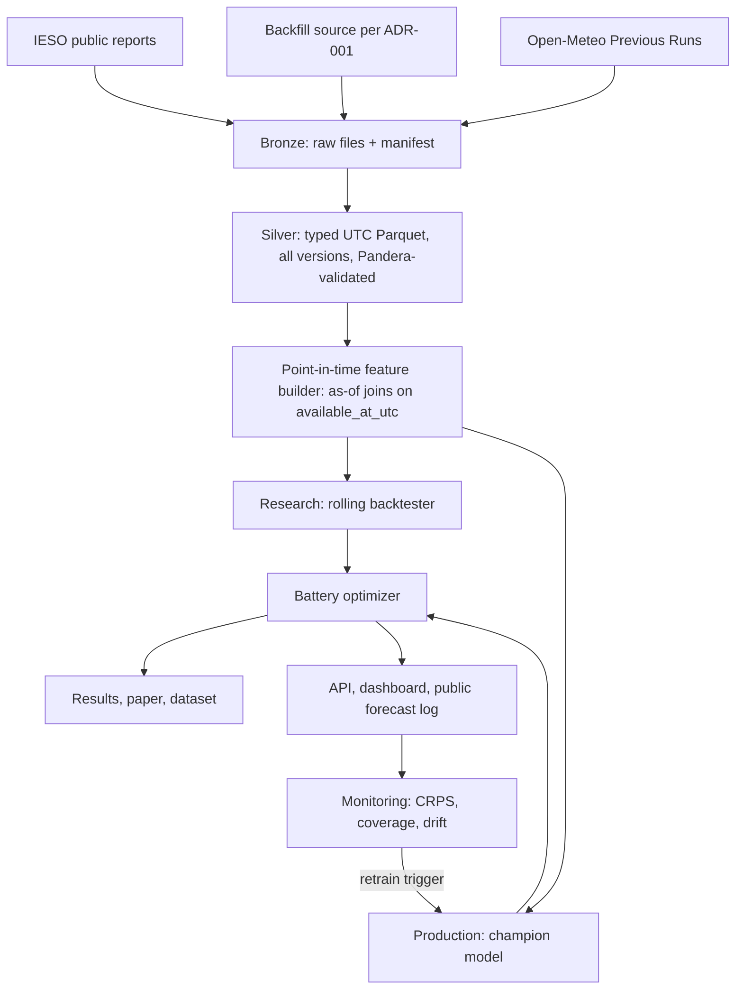
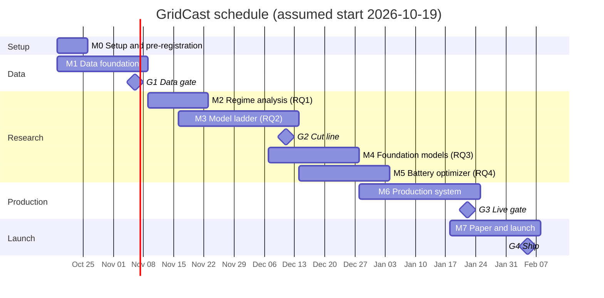

# GridCast — Project Plan and Execution Brief

> Probabilistic forecasting and battery dispatch for Ontario's renewed electricity market: a research-grade benchmark plus a live production system.

| Field | Value |
| --- | --- |
| Document type | Project management plan and execution brief for Claude Code |
| Version | 1.0 — 2026-10-15 |
| Project owner | [Your name] |
| Executor | Claude Code, supervised by the owner |
| Planned duration | 16 weeks at ~10–15 h/week (assumed start Monday 2026-10-19; adjust dates if different) |
| Status | Not started — begin at Milestone M0 |
| Companion | Narrative plan doc "GridCast — Project Plan" |

---

## 0. Operating instructions for Claude Code

Read this entire file before writing any code. Then follow these rules for the whole project:

1. **Work milestone by milestone** (M0 → M7). Inside a milestone, follow task IDs in order unless a dependency says otherwise.
2. **A task is done only when its acceptance criteria (AC) pass.** Record it in `STATUS.md` with the commit hash.
3. **Stop at every gate (G1–G4)** and write a gate report in `docs/gates/Gx.md`. Do not start the next milestone until the owner approves.
4. **`[VERIFY]`** marks facts researched on 2026-10-15 that need confirming against the primary source before code depends on them. Record each check in `docs/decisions.md`.
5. **`[OWNER]`** marks anything needing a human: accounts, API keys, spending money, publishing, licences. Ask; never improvise.
6. **Never fabricate data, numbers or citations.** Every figure in the README, dashboard or paper must be produced by code in this repo and traceable to a results file.
7. **No look-ahead leakage, ever.** No model may see information published after the forecast's issue time. The leakage tests in §7.5 must stay green.
8. **Small, conventional commits** (`feat:`, `fix:`, `test:`, `docs:`, `chore:`), ideally one task per PR.
9. **No logic in notebooks.** Notebooks are for exploration only and import from `src/`.
10. **Be a polite client** of every data source: identify a User-Agent, ≤ 1 request/second, exponential backoff, cache raw files, never re-download unchanged files.

**Suggested first prompt:** *"Read GRIDCAST_PROJECT_PLAN.md end to end. Summarise the plan in 10 bullets, list the [VERIFY] items you can check now, then execute Milestone M0 and stop for my review."*

---

## 1. Executive summary

GridCast forecasts the next day's 24 hourly **day-ahead Ontario Zonal Prices (OZP)** and Ontario demand with calibrated quantiles, turns those forecasts into charge/discharge schedules for a simulated **100 MW / 400 MWh battery**, and reports their value in **$/MW-year**.

- **Research half:** a pre-registered benchmark of a model ladder — naive → LEAR → LightGBM → deep nets → zero-shot and fine-tuned time-series foundation models (Chronos-2, TimesFM-3, Moirai 2.0, TiRex) — on a market redesigned on **1 May 2025** (Market Renewal Program: day-ahead market, locational marginal prices, OZP replacing HOEP). The redesign is a natural experiment, and the post-redesign data post-dates foundation-model pretraining corpora, giving a contamination-free test.
- **Practical half:** a monitored pipeline that publishes a timestamped forecast and battery schedule every day **before the day-ahead bid window closes**, with an API, dashboard and public scorecard.

---

## 2. Objectives and success criteria

| ID | Objective | Measure | Target (aim, not promise) |
| --- | --- | --- | --- |
| O1 | Point-in-time-correct data platform | Coverage of core reports including every published version; leakage tests | No missing hours in silver tables over the backfilled range; leakage tests green in CI |
| O2 | Rigorous benchmark | Rolling-origin backtest of ≥ 10 models over ≥ 12 months of test data with DM/GW tests and a model confidence set | Complete results for RQ1–RQ4 |
| O3 | Beat the operator | Day-ahead MAE vs. IESO pre-dispatch OZP projection, over the period those projections were collected | Diebold–Mariano p < 0.05 |
| O4 | Calibrated uncertainty | Empirical coverage of 90% intervals on test | 87–93% |
| O5 | Decision value | Revenue difference, best probabilistic strategy minus rule of thumb | 95% block-bootstrap CI excludes zero |
| O6 | Production reliability | Unattended daily operation with public scorecard | ≥ 60 consecutive days, ≤ 2 missed forecasts |
| O7 | Public outputs | Repo, dashboard, arXiv preprint, dataset (where licences allow), blog, demo video | All published by end of week 16 |

---

## 3. Scope

**In scope**

- Day-ahead hourly OZP forecasting (primary), real-time OZP and day-ahead minus real-time spread (secondary), Ontario demand (secondary).
- Probabilistic output: 21 quantiles (0.01, 0.05, 0.10, …, 0.95, 0.99).
- Battery arbitrage simulation against day-ahead OZP.
- Data platform, backtester, optimizer, API, dashboard, monitoring, paper, open dataset.

**Out of scope (deliberate)**

- Kubernetes, Kafka, microservices. The workload is a few MB/day; batch serving fits a once-a-day decision.
- Real bidding or trading of any kind.
- Forecasting every individual node's LMP.
- 5-minute intraday forecasting (stretch only).

**Stretch (only after G2 and if on schedule)**

Decision-focused learning (cvxpylayers / SPO+); zone-level forecasting and battery siting; DA–RT spread virtual-trading backtest; energy + operating-reserve co-optimisation; two-stage dispatch with real-time recourse; real Ontario batteries vs. optimal; cross-market transfer; plain-language forecast explainer.

---

## 4. Research questions (to be pre-registered)

Task M0-T4 commits `PREREGISTRATION.md` containing this table, the splits in §10 and the metrics, **before any model touches test data**.

| # | Question | Hypothesis | Test |
| --- | --- | --- | --- |
| RQ1 | Did Market Renewal change how Ontario prices behave? | Structural break in level, volatility, spike frequency and daily shape at go-live | Chow test at 2025-05-01; Bai–Perron multiple breaks; KS tests; Hill tail index; monthly count of hours above the P99 |
| RQ2 | Do zero-shot foundation models match tuned specialists? | Zero-shot TSFMs beat naive/statistical baselines but lose to tuned LightGBM/LEAR with weather and load features; fine-tuning closes most of the gap | Rolling-origin backtest; multivariate DM tests with Holm correction; GW test; 90% model confidence set; operator pre-dispatch baseline |
| RQ3 | After a redesign, which strategy recovers fastest? | TSFMs given a short post-redesign context reach baseline accuracy with fewer days of new data than models retrained from scratch | Learning curves over k ∈ {7, 14, 30, 60, 120, 240, 365} days of post-go-live data, fixed evaluation window |
| RQ4 | Does better uncertainty translate into money? | Probabilistic dispatch (mean-based, CVaR, 48-h rolling horizon) captures more perfect-foresight revenue than median-based deterministic dispatch; accuracy correlates only loosely with revenue | Backtested revenue, % of perfect foresight, block bootstrap CIs, Spearman correlation of CRPS vs. revenue across models |

RQ1 caveat to state in the paper: HOEP (old) and OZP (new) are different quantities. Build a comparable series (real-time OZP averaged to hourly) and state the limitation.

---

## 5. Verified domain facts (researched 2026-10-15)

### 5.1 Market

- Market Renewal went live on **1 May 2025**: a financially binding hourly day-ahead market, a 5-minute real-time market, locational marginal prices (LMPs), the load-weighted **Ontario Zonal Price**, nine virtual zones and virtual transactions. HOEP was discontinued.
- First-year observations (Grid Status, May 2026): ONZP averaged about $68/MWh; a small day-ahead premium (~$0.75/MWh); nodes hit the **−$100/MWh price floor**; congestion lifts southern zones (Toronto, Ottawa) and depresses the West. Use only as sanity checks.
- **Bid window:** market rules define a day-ahead "restricted window" starting **10:00 EPT on the day before** the dispatch day. **[VERIFY]** in Market Manual 4.2 (Operation of the Day-Ahead Market).
  → **GridCast issue time = 09:00 America/Toronto on D−1.**
- **Results timing:** the day-ahead OZP file for delivery day D appears around 12:30 on D−1 (example: delivery 2026-10-15 had `CreatedAt` 2026-10-14T12:31:28). **[VERIFY]** the time zone of `CreatedAt`.
- **Dispatch day:** legacy market rules define it as midnight EST to midnight EST, with prices indexed by "hour ending" 1–24. **[VERIFY]** this still holds post-redesign for each report.
- Maximum market price: **[VERIFY]** the current price cap before setting validation bounds.

### 5.2 IESO public report files

- Base URL: `https://reports-public.ieso.ca/public/<ReportName>/`
- File naming: `PUB_<ReportName>_<YYYYMMDD>.xml` (delivery date) plus versioned copies `_v1`, `_v2`, `_v3`…; `PUB_<ReportName>.xml` is the latest. **Corrections can arrive days later** (delivery 2026-09-11 received `_v2` on 2026-09-15; delivery 2026-09-24 received `_v2` and `_v3` the same afternoon). Store every version.
- XML structure (day-ahead OZP example): root `Document` in namespace `http://www.ieso.ca/schema`; `DocHeader/CreatedAt`; `DocBody/DeliveryDate`; repeated `HourlyPriceComponents` with `PricingHour`, `ZonalPrice`, `LossPriceCapped`, `CongestionPriceCapped`, `Flag`. Each report has an XSD under `/docrefs/schema/` and a help PDF under `/docrefs/helpfile/`. Parse namespace-aware (lxml).

**Retention is the single biggest project risk.** Most folders keep only 30–90 days of daily files.

| Report folder | Content | On-site retention | Long history |
| --- | --- | --- | --- |
| `DAHourlyOntarioZonalPrice` | Day-ahead OZP, hourly | ~90 days (oldest listed: delivery 2026-07-16) | Not on site → backfill |
| `RealtimeOntarioZonalPrice` | Real-time OZP, 5-min | 90 days | Not on site → backfill |
| `DAHourlyZonal`, `RealtimeZonalEnergyPrices` | Virtual zonal prices | ~90 days | Backfill |
| `PredispHourlyOntarioZonalPrice` | Operator's forward price projection | 30 days | None → collect from now on |
| `Adequacy3` | Projected demand, scheduled supply by fuel, net interties (today + 34 days) | 90 days | None → collect |
| `VGForecastSummary` | Wind/solar forecasts, 48 h | 30 days | None → collect; use weather proxies in backtests |
| `DATotals` | Day-ahead expected load, reserves, losses | 30 days | None → collect |
| `DAConstrShadowPrices` | Day-ahead binding-constraint shadow prices | 90 days | Collect |
| `Demand` | Ontario and market demand, hourly | Yearly CSVs | **2002–present** |
| `PriceHOEPPredispOR` | HOEP + 1–3 h pre-dispatch prices | CSV | **2002–May 2025** |
| `GenOutputCapabilityMonth` | Unit-level output and capability | Monthly CSV | **May 2019–present** |
| `IntertieScheduleFlowYear` | Intertie schedules and flows | Yearly CSV | **2018–present** |

**Backfill routes for post-May-2025 prices [OWNER decides in ADR-001]:**

1. **Grid Status hosted API** (`gridstatusio` Python client; free plan documented at 500,000 rows/month). Hourly day-ahead OZP for ~17 months ≈ 12,500 rows; real-time 5-min OZP ≈ 150,000 rows — fits the free tier. **[VERIFY]** dataset IDs in their catalog and the terms of use; hosted-API data is likely **not redistributable**, so exclude it from the open dataset.
2. **Request historical extracts from IESO Customer Relations** (customer.relations@ieso.ca).
3. The open-source **`gridstatus`** library parses IESO reports but only reaches what IESO currently exposes; useful to cross-check parsers.

### 5.3 Weather (Open-Meteo; free for non-commercial use)

- **Features (leak-free):** Previous Runs API — `https://previous-runs-api.open-meteo.com/v1/forecast` with variables such as `temperature_2m_previous_day1`, `temperature_2m_previous_day2` (value forecast N×24 h before valid time). Most models archived from **January 2024**; GFS 2 m temperature from March 2021.
- **Lead-offset rule:** for issue time `t_issue` and valid time `v`, use the smallest N such that `v − N·24h ≤ t_issue`. With issue at 09:00 on D−1, valid times up to 09:00 on D use N = 1; later hours of D use N = 2. Unit-test this.
- **Alternative:** Single Runs API (select a model run by its initialisation time; ECMWF IFS HRES archived from March 2024). Gives exact as-of runs but you must model publication latency. **[VERIFY]** latency. Decide in ADR-003.
- **Never use for features:** the Historical Forecast API (it stitches the first hours of each run, so it behaves like actual weather) or ERA5. Use ERA5 (`archive-api.open-meteo.com/v1/archive`) only for analysis.
- **Candidate points (lat, lon):** Toronto (43.65, −79.38), Ottawa (45.42, −75.70), Hamilton (43.26, −79.87), London (42.98, −81.25), Kitchener (43.45, −80.49), Windsor (42.31, −83.04), Chatham-Kent wind area (42.40, −82.19), Sudbury (46.49, −80.99). Weights set in M1 (e.g., by zonal demand share).
- **Variables:** `temperature_2m`, `dew_point_2m`, `wind_speed_100m`, `cloud_cover`, `shortwave_radiation`. Derived: heating/cooling degree-hours, wind-power proxy (cubic, capped), solar proxy.

### 5.4 Models and libraries

- **Chronos-2:** `pip install "chronos-forecasting>=2.0"`; `from chronos import Chronos2Pipeline`; `Chronos2Pipeline.from_pretrained("amazon/chronos-2", device_map=...)`; `pipeline.predict_df(...)` supports past-only and known-future covariates. 120M parameters, Apache-2.0, outputs 21 quantiles including 0.01/0.99. **[VERIFY]** the exact `predict_df` signature and fine-tuning API in the repo README.
- **TimesFM-3:** `google/timesfm-3.0-pytorch` (~0.3B parameters, multivariate with covariates, 9 quantiles 0.1–0.9). Weights under the **TimesFM Non-Commercial License v1.0** → research benchmark only, **never in production serving**. Evaluate its quantiles on the shared subset of levels; do not extrapolate tails silently.
- **Moirai 2.0** (`uni2ts`), **TiRex**: **[VERIFY]** package names, APIs and licences in M4.
- **epftoolbox:** LEAR and DNN reference models, DM and GW tests, rMAE.
- **arch:** `arch.bootstrap.MCS` for the model confidence set.

### 5.5 Battery context

Ontario's Oneida facility is 250 MW / 1,000 MWh (four-hour) and in commercial operation; the province has procured roughly 2,900 MW of storage. GridCast simulates a 100 MW / 400 MWh four-hour battery as a price-taker.

---

## 6. Data inventory

| ID | Dataset | Source | Grain | Used for | History route | Live collection | Priority |
| --- | --- | --- | --- | --- | --- | --- | --- |
| D01 | Day-ahead OZP | IESO `DAHourlyOntarioZonalPrice` | Hourly | Target | Backfill (ADR-001) | Daily, twice (versions) | P0 |
| D02 | Real-time OZP | IESO `RealtimeOntarioZonalPrice` | 5-min | Secondary target, spread, lags | Backfill | Hourly | P0 |
| D03 | Pre-dispatch OZP | IESO `PredispHourlyOntarioZonalPrice` | Hourly, rolling | Operator baseline | None (30 days) | Hourly | P0 |
| D04 | HOEP | IESO `PriceHOEPPredispOR` | Hourly | RQ1, RQ3 | CSV 2002–May 2025 | — | P0 |
| D05 | Demand | IESO `Demand` | Hourly | Target, features | CSV 2002–present | Daily | P0 |
| D06 | Adequacy | IESO `Adequacy3` | Hourly, published ahead | Operator demand forecast, supply features | None (90 days) | Every 3 h | P0 |
| D07 | Generator output & capability | IESO `GenOutputCapability` / `…Month` | Hourly, unit | Nuclear availability, supply mix | CSV May 2019– | Daily | P1 |
| D08 | Wind/solar forecast | IESO `VGForecastSummary` | Hourly, 48 h | Features (live only) | None (30 days) | Hourly | P1 |
| D09 | Intertie flows | IESO `IntertieScheduleFlow` / `…Year` | Hourly | Features | CSV 2018– | Daily | P1 |
| D10 | Virtual zonal prices | IESO `DAHourlyZonal` | Hourly | Stretch (zones) | Backfill | Daily | P2 |
| D11 | DA shadow prices | IESO `DAConstrShadowPrices` | Hourly | Congestion features (stretch) | None (90 days) | Daily | P2 |
| D12 | Weather forecasts | Open-Meteo Previous Runs | Hourly | Features | Jan 2024– | Daily | P0 |
| D13 | Weather actuals | Open-Meteo ERA5 archive | Hourly | Analysis only | 1940– | Weekly | P2 |
| D14 | Holidays | `holidays` package (Ontario) | Daily | Features | — | — | P0 |
| D15 | Gas price | [OWNER picks source] | Daily | Optional feature | — | — | P2 |

---

## 7. Architecture and data contracts

### 7.1 Flow



### 7.2 Storage layout

```
data/bronze/ieso/<Report>/<delivery_date>/<original_filename>__<fetched_at_utc>.xml
data/bronze/_manifest.parquet   # report, url, filename, version, delivery_date, doc_created_at,
                                # fetched_at_utc, sha256, bytes, http_status
data/silver/<table>/month=YYYY-MM/*.parquet
data/gold/features/…, data/gold/forecasts/…, data/gold/dispatch/…
```

Local development uses the filesystem; production uses an S3-compatible bucket **[OWNER, ADR-002]**. DuckDB queries Parquet directly in both.

### 7.3 Canonical time model

- `ts_utc`: interval **start**, timezone-aware UTC. All joins use it.
- Keep source fields `delivery_date` and `hour_ending` (1–24) for traceability.
- Conversion, if reports use EST year-round **[VERIFY]**: `ts_utc = (delivery_date 00:00 at fixed UTC−5) + (hour_ending − 1) h`. Otherwise use `America/Toronto` with explicit DST handling.
- Mandatory tests on DST days: **2025-11-02, 2026-03-08, 2026-11-01** (each must yield exactly the expected number of hourly rows and no duplicates).
- `available_at_utc`: when a value became knowable = `doc_created_at` (converted) when present, else `fetched_at_utc`. For backfilled data without vintages, use a conservative publication-lag rule per report, declared in `configs/availability.yaml` (e.g., day-ahead OZP for D available at 13:00 Eastern on D−1).

### 7.4 Silver schema example — `da_ozp`

| Column | Type | Notes |
| --- | --- | --- |
| `ts_utc` | timestamp[UTC] | Interval start |
| `delivery_date` | date | From `DeliveryDate` |
| `hour_ending` | int8 | 1–24 from `PricingHour` |
| `zonal_price` | float64 | $/MWh |
| `loss_price_capped` | float64 | $/MWh |
| `congestion_price_capped` | float64 | $/MWh |
| `flag` | string | e.g. `DSO-RD` |
| `version` | int16 | 0 = base file, 1 = `_v1`, … |
| `doc_created_at` | timestamp[UTC] | From `CreatedAt` |
| `available_at_utc` | timestamp[UTC] | See §7.3 |
| `source_sha256` | string | Links to bronze |

Primary key `(ts_utc, version)`. Views: `da_ozp_latest` (highest version per `ts_utc`) and a function `da_ozp_asof(t)` returning, per `ts_utc`, the highest version with `available_at_utc ≤ t`. Forecast-type reports (pre-dispatch, adequacy, VG forecast) are keyed by `(issued_at_utc, target_ts_utc)`.

### 7.5 Point-in-time rules and leakage tests

- `build_features(issue_time_utc, target_day) -> DataFrame`: every input joined with `available_at_utc ≤ issue_time_utc` (DuckDB `ASOF JOIN` or explicit filter).
- Required tests, run in CI on every PR:
  1. **Property test:** for random issue times, `max(available_at_utc)` over all inputs used ≤ issue time.
  2. **Canary test:** inject a sentinel row published one second after issue time; assert it never appears in features.
  3. **Weather lead-offset test** per §5.3.
  4. **Determinism test:** same config and seed → identical forecasts.

### 7.6 Model interface

```python
from datetime import date, datetime
from typing import Protocol, Sequence
import pandas as pd

QUANTILES: tuple[float, ...] = (0.01, *[round(i / 20, 2) for i in range(1, 20)], 0.99)  # 21 levels


class Forecaster(Protocol):
    name: str

    def fit(self, features: pd.DataFrame, target: pd.Series, *, as_of: datetime) -> None: ...

    def predict_quantiles(
        self,
        features: pd.DataFrame,
        *,
        as_of: datetime,
        target_day: date,
        quantiles: Sequence[float] = QUANTILES,
    ) -> pd.DataFrame:
        """Long frame with columns ts_utc, quantile, value. Quantiles must be
        non-crossing (sort per ts_utc) and cover the 24 hours of target_day."""
```

**Forecast record** (`gold/forecasts`): `run_id, model_name, model_version, git_sha, config_hash, data_snapshot_id, issued_at_utc, target_ts_utc, quantile, value, created_at_utc`.

---

## 8. Work breakdown structure

Each task lists its acceptance criteria (AC). Estimates assume ~10–15 h/week of owner-supervised agent work.

### M0 — Setup and pre-registration (week 1)

| ID | Task | AC |
| --- | --- | --- |
| M0-T1 | Scaffold repo: uv, Python 3.12, `src/gridcast` layout, ruff, mypy (strict on `src`), pytest, pre-commit, Makefile, GitHub Actions CI | `make check` passes on a clean clone; CI green |
| M0-T2 | Config system (Hydra or pydantic-settings), `.env.example`, secrets never committed | Config loads in a test; `git secrets`/gitleaks hook active |
| M0-T3 | `docs/decisions.md` (ADR log), `STATUS.md`, `docs/data_sources.md` | Files exist with templates from §16 |
| M0-T4 | Commit `PREREGISTRATION.md` (§4 + §10 + metrics), dated | Commit hash recorded in README |
| M0-T5 | `[VERIFY]` sweep for items checkable now (bid window, time convention, price cap, file formats) | Results logged in `docs/decisions.md` |

### M1 — Data foundation (weeks 1–3) → Gate G1

| ID | Task | AC |
| --- | --- | --- |
| M1-T1 | **Data-availability audit first:** earliest available date per dataset D01–D15 on the IESO site, Grid Status catalog and other routes; recommendation for ADR-001 | `docs/data_availability.md` complete; owner approves ADR-001 |
| M1-T2 | Generic `ReportCollector(report)`: parse folder index, download new files and versions, write bronze + manifest, idempotent by sha256, polite networking | Second run downloads nothing; tests use recorded fixtures (no network in CI) |
| M1-T3 | **Live snapshot scheduler — start immediately.** Interim cron (GitHub Actions or a small VM) until Dagster in M6. Cadence: D01 daily at ~13:30 and ~18:00 Eastern; D02, D03, D08 hourly; D06 every 3 h; others daily | Runs unattended; gap report shows 7 consecutive gap-free days |
| M1-T4 | Parsers → silver for D01–D11 with Pandera schemas, namespace-aware lxml, optional XSD validation | Golden-file test per report; schema tests |
| M1-T5 | Backfill: historical CSVs (D04, D05, D07, D09) + chosen post-May-2025 price route | Coverage report shows continuous hourly series; remaining gaps listed |
| M1-T6 | Weather ingest (Previous Runs API) for the chosen points/variables, lead offsets 1–2; ERA5 for analysis | Lead-offset unit tests pass; quota-safe caching |
| M1-T7 | Canonical time model (§7.3) | DST tests on the three dates pass |
| M1-T8 | `configs/availability.yaml`, as-of feature builder skeleton, leakage tests (§7.5) | All four leakage tests green in CI |
| M1-T9 | `make dq`: data-quality report (coverage, gaps, duplicates, out-of-range values, version counts) | Report generated; anomalies triaged |

**Gate G1 (end of week 3, ~2026-11-06):** full obtainable history loaded; ≥ 7 days of gap-free live snapshots; leakage tests green; ADR-001 approved.

### M2 — Regime analysis, RQ1 (weeks 4–5)

| ID | Task | AC |
| --- | --- | --- |
| M2-T1 | EDA notebook (imports `src`): daily/weekly shapes, distributions, spikes > P99, negative and floor prices, DA–RT spread, loss/congestion components | Notebook runs top to bottom |
| M2-T2 | Comparable pre/post series (HOEP vs. hourly-averaged RT OZP) + written limitation | Function + test; limitation in `docs/results/rq1.md` |
| M2-T3 | Break tests: Chow at 2025-05-01, Bai–Perron (`ruptures` or statsmodels), KS, Hill tail index, rolling volatility | Script outputs JSON results |
| M2-T4 | Figures generated by scripts into `paper/figures/` | `make figures` regenerates all |
| M2-T5 | RQ1 verdict | `docs/results/rq1.md` |

### M3 — Model ladder, RQ2 (weeks 5–8) → Gate G2 (cut line)

| ID | Task | AC |
| --- | --- | --- |
| M3-T1 | Backtester: rolling origin, configurable refit frequency (daily for cheap models, weekly refit + daily predict for expensive ones), parallel by date, resumable, cached forecasts in gold | Deterministic; runtime logged per model |
| M3-T2 | Metrics: MAE, RMSE, rMAE (vs. weekly naive p(d−7, h)), pinball, CRPS (quantile approximation), coverage, width, PIT, spike-hour MAE, spike precision/recall | Unit tests vs. hand-computed cases |
| M3-T3 | Significance: multivariate DM (daily L1 norm) and per-hour DM, GW (epftoolbox), Holm correction, MCS (`arch`) | Tests on synthetic data with known answers |
| M3-T4 | Tier 0: naive d−1, naive d−7, operator pre-dispatch (only over collected window) | In results tables |
| M3-T5 | Tier 1: LEAR (epftoolbox, asinh transform, calibration-window ensemble), SARIMAX | In results tables |
| M3-T6 | Tier 2: LightGBM quantile models; Optuna on the validation window only; frozen configs committed to `configs/frozen/` | Frozen-config commit hash recorded |
| M3-T7 | Tier 3: epftoolbox DNN, N-HiTS, TFT, PatchTST (neuralforecast), 3 seeds each | Mean ± std reported |
| M3-T8 | Conformal wrapper: CQR + adaptive conformal inference for any model | Coverage improves or holds on validation |
| M3-T9 | Auto-generated `docs/results/rq2.md` | Regenerated by `make results` |
| M3-T10 | **Early live publishing:** after G2, publish the champion's daily forecast via the interim scheduler so the public scorecard starts accruing | First timestamped forecast published |

**Gate G2 (end of week 8, ~2026-12-11):** tiers 0–2 complete on the full test window with frozen configs. If not met → drop all stretch work and make fine-tuning (M4-T3) optional.

### M4 — Foundation models, RQ3 (weeks 8–10)

| ID | Task | AC |
| --- | --- | --- |
| M4-T1 | Wrappers implementing `Forecaster` for Chronos-2 (with covariates), TimesFM-3, Moirai 2.0, TiRex | Interface tests pass |
| M4-T2 | Zero-shot backtests under the same protocol | In results tables |
| M4-T3 | Fine-tune Chronos-2 on pre-test data only | Compared to zero-shot |
| M4-T4 | Learning curves over k ∈ {7…365} days, with and without old-market history | Plot + table |
| M4-T5 | Ablations: context length, covariates on/off | In results |
| M4-T6 | Quantile regression averaging ensemble of best 3–5 (weights fit on validation only) | In results |
| M4-T7 | Compute log: GPU hours and per-day inference time for every model (an epftoolbox best practice) | Table in `docs/results/compute.md` |

### M5 — Battery optimizer, RQ4 (weeks 9–11)

| ID | Task | AC |
| --- | --- | --- |
| M5-T1 | Battery MILP per §11 (Pyomo or CVXPY + HiGHS) | Unit tests on hand-checkable days pass |
| M5-T2 | Scenario generator: Gaussian copula on PIT residuals across 24 h; 200–500 scenarios | Marginals reproduce the forecast quantiles within tolerance |
| M5-T3 | Strategies per §11 | All run on the full test window |
| M5-T4 | Settlement simulator (DA schedule settled at actual DA OZP; state of charge carried across days) | Reconciles to hand calculation on a sample week |
| M5-T5 | Block bootstrap (weekly blocks) and sensitivity sweeps (efficiency, degradation cost, battery size 10–250 MW) | Tables + plots |
| M5-T6 | RQ4 verdict | `docs/results/rq4.md` |

### M6 — Production system (weeks 11–14) → Gate G3

| ID | Task | AC |
| --- | --- | --- |
| M6-T1 | Dagster assets and schedules replace the interim cron | Asset lineage visible; schedules running |
| M6-T2 | MLflow tracking and registry; champion–challenger rule (rolling 60-day CRPS) | Promotion logged automatically |
| M6-T3 | Daily job: features as of 09:00 Eastern on D−1, forecast D, optimise, write records, publish to the public append-only forecast log before 10:00 Eastern | Job completes in < 30 min; log entries timestamped |
| M6-T4 | FastAPI: `/health`, `/forecast/day-ahead?date=`, `/forecast/quantiles?date=`, `/dispatch/schedule?date=`, `/scorecard` with pydantic models | API tests; OpenAPI docs render |
| M6-T5 | Docker image and deployment to the host chosen in ADR-002 | Public URL live; secrets in host secret store |
| M6-T6 | Monitoring: rolling CRPS/MAE/coverage once actuals arrive, PSI feature drift, alert when 7-day 90%-coverage < 80% or a job fails (channel per ADR-004), retrain trigger | Alert fires in a forced test |
| M6-T7 | Dashboard (Streamlit default): tomorrow's fan chart, battery schedule, scorecard vs. actuals, leaderboard | Deployed and linked from README |
| M6-T8 | `docs/runbook.md`: report format change, late data, failed job, model rollback | Reviewed by owner |

**Gate G3 (end of week 14, ~2027-01-22):** 14 consecutive unattended days; scorecard public.

### M7 — Paper and launch (weeks 14–16) → Gate G4

| ID | Task | AC |
| --- | --- | --- |
| M7-T1 | `make paper`: LaTeX with every table and figure generated from results files | Builds from clean checkout |
| M7-T2 | Dataset packaging with only redistributable sources (check IESO terms **[VERIFY]**), datasheet, DOI via Zenodo or Hugging Face **[OWNER]** | Dataset page live |
| M7-T3 | README (pitch, architecture diagram, headline numbers auto-filled from results JSON), blog post, 3-minute video script | Owner review |
| M7-T4 | Reproducibility check: fresh clone on a clean machine → `make data backtest paper` with documented data-access steps | Two independent successful runs |
| M7-T5 | arXiv submission **[OWNER]** | arXiv ID in README |

**Gate G4 (end of week 16, ~2027-02-05):** everything public; the scorecard keeps running until it passes 60 days.

---

## 9. Schedule



The plan crosses the December holidays; treat 2026-12-24 to 2027-01-01 as buffer.

**Critical path:** M1-T1 (audit) → M1-T5 (backfill) → M3-T1 (backtester) → M3-T6 (frozen tier 2) → M5 → M6-T3 (daily job). The live collector (M1-T3) is time-critical: every day it is not running is forward-report history lost permanently.

---

## 10. Evaluation protocol

**Splits (fixed in pre-registration)**

| Split | Range | Use |
| --- | --- | --- |
| Old market | 2019-01-01 → 2025-04-30 (HOEP era) | RQ1; pretraining/transfer in RQ3 |
| Validation | 2025-05-01 → 2025-10-31 | Hyperparameter tuning, conformal calibration, ensemble weights |
| Test | 2025-11-01 → latest available (≥ 12 months from early November 2026) | All headline results; never used for tuning |
| Operator comparison | Dates with collected pre-dispatch vintages | O3 only |
| Live out-of-sample | From the first public forecast | Scorecard; never used for tuning |

If ADR-001 cannot secure post-redesign history, fall back to: test on the ~90 days available on site plus the live period, report wider confidence intervals, and frame RQ3 on the available window. Record this as a deviation from pre-registration.

**Metrics:** MAE, RMSE, rMAE (weekly naive), CRPS via average pinball loss over the 21 quantiles, 80%/90% interval coverage and width, PIT histograms, spike-hour MAE (top 5% of hours), spike precision/recall. Avoid MAPE/sMAPE: prices sit near zero and hit −$100/MWh.

**Statistics:** multivariate DM on daily 24-hour L1 error norms plus per-hour DM; GW test; Holm correction; 90% model confidence set; 95% block-bootstrap intervals (weekly blocks).

**Robustness:** 3–5 seeds for neural models; ablations (weather off, operator features off, context length); error breakdown by hour, season, temperature band and congestion events; three worst-day case studies.

**Price transform:** asinh variance-stabilising transform for tiers 1–3.

**Compute reporting:** training and inference time per model per day.

---

## 11. Battery optimization specification

**Decision variables per hour t = 1…T:** charge `c_t ≥ 0`, discharge `d_t ≥ 0` (MW), state of charge `s_t` (MWh), binary `u_t` (1 = charging allowed).

```
maximise   Σ_t p_t · (d_t − c_t) − κ · Σ_t (c_t + d_t)
subject to s_{t+1} = s_t + η_c · c_t − d_t / η_d
           s_min ≤ s_t ≤ s_max
           c_t ≤ P · u_t,   d_t ≤ P · (1 − u_t)
           s_1 = s_init  (carried over from the previous day)
           terminal condition per strategy (below)
```

| Parameter | Default | Sweep |
| --- | --- | --- |
| Power P | 100 MW | 10–250 MW |
| Energy | 400 MWh | 4 h duration fixed |
| SoC bounds | 10%–90% | — |
| Round-trip efficiency | 88% (η_c = η_d = √0.88) | 85–90% |
| Degradation κ | $10/MWh throughput | $5–20/MWh |
| Market | Day-ahead schedule settled at actual DA OZP; price-taker | — |

**Important modelling note.** With a single schedule fixed day-ahead and revenue linear in price, maximising expected revenue over scenarios equals optimising on the **mean** forecast. Probabilistic forecasts therefore add value through: (a) mean vs. median, (b) risk aversion (CVaR), (c) a 48-hour rolling horizon that values end-of-day state of charge, and (d) recourse (a real-time second stage) as a stretch.

**Strategies**

1. Perfect foresight (upper bound).
2. Rule of thumb: charge in the 4 cheapest forecast hours, discharge in the 4 dearest.
3. Deterministic on the median forecast, 24-h horizon, terminal SoC = initial.
4. Deterministic on the mean forecast (computed from quantiles), 24-h horizon.
5. 48-hour rolling horizon on scenarios (commit day D, re-plan daily).
6. Risk-averse: maximise mean − λ·CVaR₀.₉₅ of loss over scenarios, λ ∈ {0.25, 0.5, 1}.
7. Stretch: two-stage with real-time recourse; PPO agent.

**Report:** $/MW-year, % of perfect foresight, value of forecast (vs. naive forecast), value of probabilistic information (strategies 4–6 vs. 3), cycles/day, revenue per cycle, worst day, 5% CVaR of daily revenue, bootstrap CIs.

---

## 12. Engineering standards

**Repository layout**

```
gridcast/
├── README.md
├── PREREGISTRATION.md
├── GRIDCAST_PROJECT_PLAN.md      # this file
├── STATUS.md
├── Makefile                      # check | data | dq | backtest | results | figures | paper | serve
├── pyproject.toml / uv.lock
├── configs/                      # Hydra: data, availability, models, backtest, battery, frozen/
├── src/gridcast/
│   ├── ingest/                   # collectors (IESO, backfill source, weather)
│   ├── parse/                    # XML/CSV parsers → silver
│   ├── quality/                  # Pandera schemas, dq report
│   ├── timeutil/                 # canonical time model
│   ├── features/                 # point-in-time feature builders
│   ├── models/                   # Forecaster implementations
│   ├── backtest/                 # rolling-origin engine
│   ├── evaluate/                 # metrics, DM/GW, MCS, bootstrap
│   ├── dispatch/                 # battery MILP, scenarios, strategies, settlement
│   ├── pipelines/                # Dagster assets and schedules
│   ├── serve/                    # FastAPI app
│   └── monitor/                  # drift, accuracy, alerts
├── dashboard/
├── tests/                        # unit, leakage, golden-file, integration (fixtures recorded)
├── notebooks/                    # EDA only
├── docs/                         # decisions.md, data_availability.md, runbook.md, results/, gates/
└── paper/
```

**Standards**

- Python 3.12, uv, ruff (lint + format), mypy strict on `src/`, pytest with ≥ 80% coverage on `src/`.
- Network calls never run in CI; use recorded fixtures (e.g. respx/vcrpy).
- Structured logging (structlog) with `run_id` on every log line.
- Every result file carries `git_sha`, `config_hash` and `data_snapshot_id`.
- Seeds fixed and recorded; determinism tested.
- CI: lint → type-check → unit + leakage tests → build image (main only) → deploy (main only) → nightly two-week smoke backtest.
- PR template: linked task ID, AC checklist, leakage-impact statement.

---

## 13. Risk register

| ID | Risk | Likelihood | Impact | Mitigation | Trigger |
| --- | --- | --- | --- | --- | --- |
| R1 | Post-redesign price history unobtainable (site keeps ~90 days) | Medium | High | Audit first (M1-T1); Grid Status API; request to IESO; fallback design in §10 | ADR-001 unresolved by end of week 2 |
| R2 | Forward-report history lost (30–90-day retention) | High if collector late | High | Start live collector in week 1; monitor gaps daily | Any gap > 2 h |
| R3 | Report schema or name changes | Medium | Medium | Version-aware parsers, schema checks, alert on unknown fields | Parser failure |
| R4 | Look-ahead leakage | Medium | High | §7.5 tests; lead-offset rule; as-of joins | Any leakage test failure |
| R5 | Licence violations (TimesFM-3 non-commercial; Open-Meteo free tier non-commercial; hosted-API redistribution) | Low | High | Research-only use; licence notes in README; exclude non-redistributable data from dataset | Any production/commercial use |
| R6 | Free-tier quota exhaustion (Grid Status, Open-Meteo) | Medium | Low | Cache; `limit` on every query; hourly not 5-min where possible | Usage > 70% of quota |
| R7 | Small test set → weak significance | Medium | Medium | Report CIs; extend test as data accrues; live scorecard | CIs straddle zero everywhere |
| R8 | Time-zone / DST errors | Medium | High | Canonical time model; DST tests | DST test failure |
| R9 | Scope creep | High | Medium | Gate G2 cut line | Behind schedule at G2 |
| R10 | Compute shortfall for foundation models | Low | Medium | Smallest variants; CPU inference; free Colab/Kaggle GPU | Backtest > 24 h |
| R11 | Price-taker assumption unrealistic at large sizes | Certain | Low | State limitation; size sensitivity | — |
| R12 | Null results | Medium | Low | Pre-registration makes them publishable | — |

---

## 14. Decision log

**Pre-made decisions (ADR-000):** Python 3.12 + uv; Parquet + DuckDB; Dagster; MLflow; FastAPI; Streamlit; Pyomo/CVXPY + HiGHS; issue time 09:00 Eastern on D−1; 21-quantile grid; splits in §10; battery defaults in §11; TimesFM-3 research-only; Chronos-2 or in-house models for production.

**Open decisions [OWNER]:**

| ADR | Decision | Needed by |
| --- | --- | --- |
| ADR-001 | Backfill route for post-May-2025 prices | End of week 2 |
| ADR-002 | Cloud host and object storage | Week 11 (interim cron host by week 1) |
| ADR-003 | Weather API: Previous Runs vs. Single Runs, and which model | Week 2 |
| ADR-004 | Alert channel (email, Slack, webhook) | Week 12 |
| ADR-005 | Public forecast log location (public repo vs. hosted JSON) | Week 8 |
| ADR-006 | Gas price source (optional) | Week 5 |
| ADR-007 | Paper venue / workshop | Week 12 |

---

## 15. Definition of Done (every task)

- Code typed, linted, tested; CI green.
- Acceptance criteria met and demonstrated (command + output in the PR).
- No secrets committed; no network in tests.
- Leakage tests still green.
- Docs and `STATUS.md` updated; results reproducible via a `make` target.

---

## 16. Status reporting

Update `STATUS.md` at the end of every working session and summarise weekly:

```markdown
# Status — week N (YYYY-MM-DD)
Milestone: M_ | Overall: Green / Amber / Red
Done: - [M_-T_] description (commit abc123)
Next: - [M_-T_] …
Blocked / needs owner: - …
Risks changed: - R_ …
Data health: last D01 file fetched …; live-collector gaps (7 d): …
Metrics snapshot (if available): test CRPS …, 90% coverage …, live days …
```

Gate reports (`docs/gates/Gx.md`): criteria with evidence, open risks, recommendation (proceed / proceed with cuts / stop).

---

## 17. Outputs for the owner's resume

Fill brackets only from results files; never round in your favour.

- Built and deployed GridCast, a probabilistic electricity-price forecasting service (Python, PyTorch, FastAPI, Docker, Dagster) publishing daily quantile forecasts for Ontario's day-ahead market; [N] days unattended, [X]% 90%-interval coverage.
- Benchmarked [N] models incl. zero-shot foundation models (Chronos-2, TimesFM-3) on post-Market-Renewal prices with rolling-origin backtests and Diebold–Mariano tests; best model beat the operator's projection by [X]% MAE (p < 0.05).
- Formulated battery arbitrage as a risk-aware MILP over copula-sampled price scenarios (Pyomo, HiGHS); earned $[Z]/MW-year, [P]% of perfect foresight.
- Engineered a point-in-time-correct pipeline over [N] grid-operator reports with versioned snapshots, Pandera validation and as-of joins; leakage tests in CI.

---

## 18. References

- IESO public reports: https://reports-public.ieso.ca/public/
- IESO Data Directory (retention, historical files): https://ieso.ca/Power-Data/Data-Directory
- IESO Market Data Explained: https://ieso.ca/Market-Data/Market-Data-Explained
- Grid Status, "One Year of IESO Market Renewal in Ontario" (2026-05-08): https://blog.gridstatus.io/one-year-of-ieso-market-renewal/
- gridstatusio (hosted API client): https://github.com/gridstatus/gridstatusio
- gridstatus (open-source library): https://opensource.gridstatus.io/
- Open-Meteo Previous Runs API: https://open-meteo.com/en/docs/previous-runs-api
- Open-Meteo Historical Forecast API: https://open-meteo.com/en/docs/historical-forecast-api
- Open-Meteo Historical Weather (ERA5): https://open-meteo.com/en/docs/historical-weather-api
- Lago et al. (2021), day-ahead EPF best practices and epftoolbox: https://arxiv.org/abs/2008.08004 · https://github.com/jeslago/epftoolbox
- Chronos-2 technical report: https://arxiv.org/abs/2510.15821 · package: https://pypi.org/project/chronos-forecasting/
- TimesFM-3 weights and licence: https://huggingface.co/google/timesfm-3.0-pytorch
- Oneida Energy Storage: https://www.northlandpower.com/en/projects-and-updates/oneida-energy-storage.aspx
- Ontario storage procurement: https://www.power-eng.com/energy-storage/batteries/ontario-completes-canadas-largest-battery-storage-procurement/
